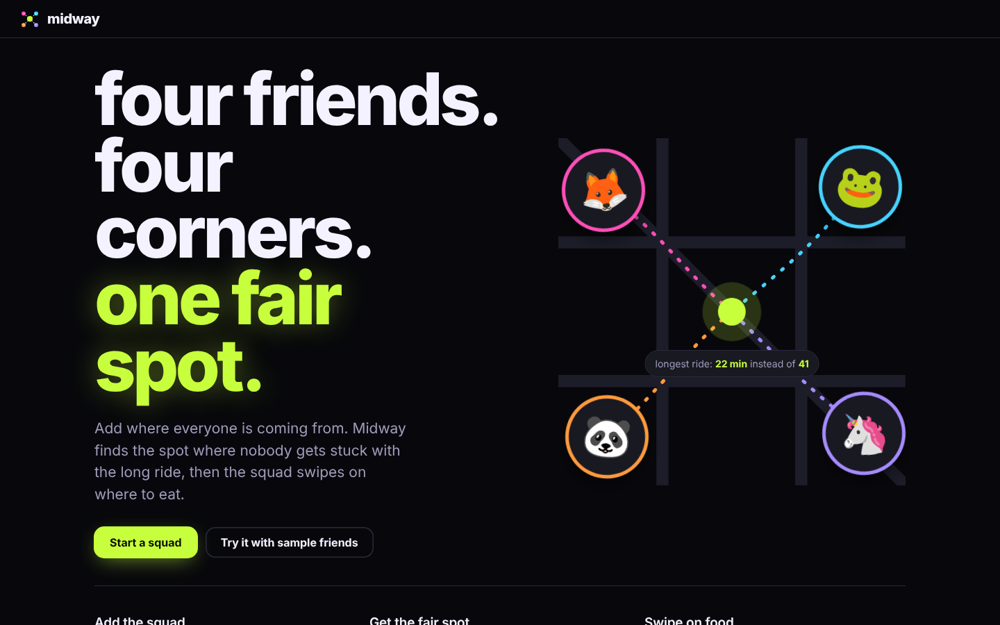
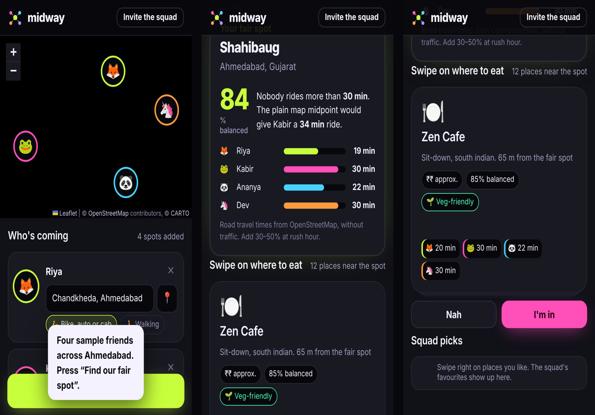

# Midway: find the fair spot to meet

Four friends live in four corners of the same city, at different colleges, and nobody wants to be the one stuck with a 45-minute ride. Midway finds the meeting spot that is **fair to everyone**, shows the cafés and restaurants around it, and lets the squad **swipe to vote** on where to eat.



**Live app:** `https://<your-github-username>.github.io/midway/` (see "Publish it" below)

## What it does

- **Add the squad.** Each friend types an area, college or metro station (search as you type), uses their phone's location, or drops a pin on the map. Up to 8 friends, each travelling by road (bike, auto or cab) or on foot.
- **Get the fair spot.** Midway times real road trips from every friend to about 75 possible meeting points and picks the one where the **longest ride is as short as possible**. It also shows how unfair the plain map midpoint would have been.
- **See places to eat around it.** Cafés, quick bites, sit-down places and dessert from OpenStreetMap, filtered by vibe, veg-friendly and budget.
- **Swipe to vote.** Tinder-style cards show each friend's travel time to each place. The squad's favourites rise to the top, and each friend gets a Google Maps route button.
- **One link for the whole squad.** Share it on WhatsApp. In a live room, everyone adds their own spot from their own phone and votes update live. Spots are rounded to about 100 m before they are shared.



## How "fair" is worked out

The plain midpoint on a map is rarely fair: roads, rivers and the shape of the city mean one friend can end up with double the ride of everyone else. Midway works with **travel time**, not distance:

1. **Coarse search.** It lays a 7 × 7 grid of candidate points over the box that holds everyone. One routing request returns a matrix of travel times, friend by candidate, from the free OSRM "table" service.
2. **Score each point.** cost = longest ride + 0.25 × average ride.
   - The longest ride carries most of the weight: this is a *minimax* objective, so nobody gets stuck with the long trip.
   - The average breaks ties, so the app doesn't pick a spot that is equally far for everyone.
3. **Sharpen.** A finer 5 × 5 grid around the best point gives a second matrix, and the better of the two wins.
4. **Places to eat.** It finds named cafés and restaurants around the spot (OpenStreetMap via Overpass). If the area is quiet, the circle widens from 1.2 km to 2.5 km to 4.5 km. Then it times every friend to every place and ranks them by the same fairness cost.
5. **Balance score.** Average ride ÷ longest ride, as a percentage. 100% means everyone travels exactly the same time.

The maths lives in [`js/fair.js`](js/fair.js): Weiszfeld's geometric median, the candidate grids, the cost and balance functions. All of these are pure functions that are easy to test.

## Built with

| Part | Tool | Cost |
|---|---|---|
| Page | Plain HTML, CSS and JavaScript modules (no build step) | Free |
| Map | Leaflet 1.9.4 + CARTO dark tiles | Free |
| Place search | Photon (by komoot), built on OpenStreetMap | Free, no key |
| Travel times | OSRM table service (FOSSGIS servers, then the OSRM demo server) | Free, no key |
| Places to eat | OpenStreetMap via the Overpass API | Free, no key |
| Live rooms (optional) | Google Firebase Cloud Firestore | Free plan |
| Hosting | GitHub Pages | Free |

**These free services are shared, so they have fair-use limits.** Every call has a fallback. If routing is busy, travel times are estimated from distance and the app says so.

## Run it on your laptop

ES modules need a local web server (opening the file directly won't work):

```
cd midway
python -m http.server 8000
```

Then open http://localhost:8000. Click **Try it with sample friends** for four friends across Ahmedabad.

## Publish it (GitHub Pages)

1. Publish the folder to GitHub with GitHub Desktop as a **public** repository named `midway`.
2. On github.com, open the repo and go to **Settings → Pages**. Choose **Deploy from a branch**, then branch `main` and folder `/ (root)`, and click **Save**.
3. After about a minute the app is live at `https://<your-username>.github.io/midway/`.

## Turn on live rooms (optional, about 5 minutes)

Without this step, Midway still works: one person can add everyone, or share a squad link that carries the spots. Live rooms let every friend add their own spot from their own phone, and votes sync instantly.

1. Go to [console.firebase.google.com](https://console.firebase.google.com) and click **Create a project**. Name it `midway`; Google Analytics is not needed.
2. Open **Build → Firestore Database → Create database**. Pick the location `asia-south1 (Mumbai)` and start in **production mode**.
3. Open the **Rules** tab, paste in [`firestore.rules`](firestore.rules) and click **Publish**.
4. Click the gear icon, then **Project settings**. Under **Your apps**, click the web icon `</>`, name the app `midway` and click **Register app**. Copy the `firebaseConfig` object it shows.
5. Paste that object into [`js/config.js`](js/config.js) in place of `null`, then push.
6. Optional: in Firestore, open **TTL policies**, set the collection group to `rooms` and the field to `expires`. Rooms then delete themselves after a week.

The Firebase web config is meant to be public: what protects the data is the rules file. Rooms can only be opened with their 6-character code, cannot be listed or deleted, and hold at most 8 friends.

## Privacy

- Locations are rounded to about 100 m before they are shared in a link or a room.
- There are no accounts and no tracking.
- The squad link carries the friends' rounded spots inside the link itself, so share it only with the squad.

## Limits, honestly

- Travel times come from OpenStreetMap roads **without live traffic**. At rush hour, add 30–50%. Transit (metro and bus) is not modelled.
- OpenStreetMap rarely has prices, so the budget band is **estimated from the type of place**: street food and quick bites ₹, cafés and most restaurants ₹₹, bars and fine dining ₹₹₹.
- "Veg-friendly" uses OpenStreetMap's `diet:vegetarian` and cuisine tags, which are often missing in Indian cities. That is why it sorts veg-tagged places first instead of hiding the rest.

## Project structure

```
midway/
├── index.html          the landing page and the planner
├── styles.css          the neon-night look (Unbounded + Bricolage Grotesque)
├── js/
│   ├── app.js          screens, friends, map, results, voting
│   ├── fair.js         the maths: grids, geometric median, fairness cost, balance
│   ├── finder.js       the search pipeline: coarse grid, fine grid, places, ranking
│   ├── services.js     search, travel times and places, each with a fallback
│   ├── room.js         live rooms (Firebase) and squad links
│   ├── swipe.js        the swipe deck
│   ├── demo.js         the Ahmedabad sample squad
│   └── config.js       Firebase config and service addresses
├── firestore.rules     database rules for live rooms
└── images/             screenshots for this README
```

## Talking about it in an interview

- **The problem:** "fair" is not the map midpoint. I measured fairness in travel time and turned the choice into an optimisation: minimise the longest trip (minimax), with the average as a tie-breaker.
- **The method:** a coarse-to-fine grid search over travel-time matrices. That takes 3 routing requests instead of hundreds, so it stays inside free API limits.
- **Engineering:** each free service has a fallback; rooms sync live through Firestore; spots are rounded for privacy; the site is static and costs nothing to host.
- **What I would add next:** metro and bus times, opening hours, and a "rush hour" switch using historical traffic.

## Credits

Map data © [OpenStreetMap](https://www.openstreetmap.org/copyright) contributors (ODbL). Map tiles © [CARTO](https://carto.com/attributions). Search by [Photon](https://photon.komoot.io). Travel times by [OSRM](https://project-osrm.org), hosted by [FOSSGIS](https://routing.openstreetmap.de). Places via the [Overpass API](https://overpass-api.de).
